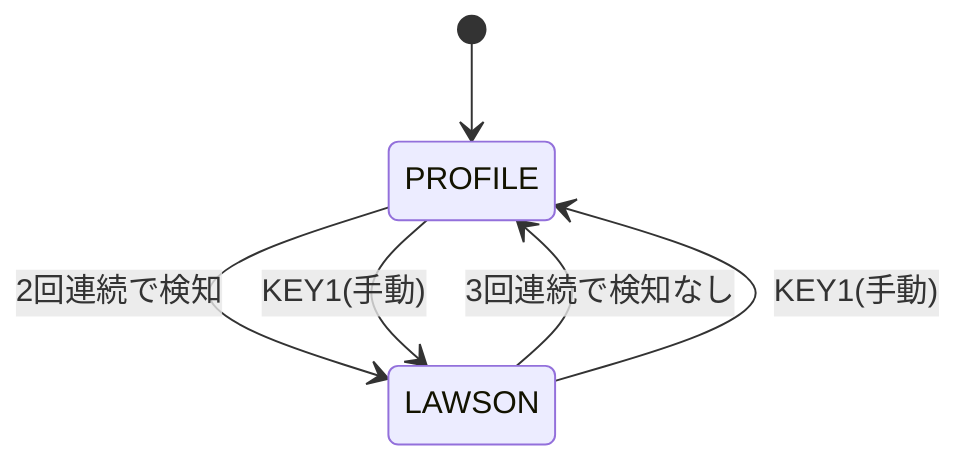

# プロトタイプ設計:ローソン検知でPonta表示

更新: 2026-11-23 / 方針は `policy.md` を参照

## 1. 目的と範囲

ローソンのWi-Fi(`LAWSON_Free_Wi-Fi`)を検知したら、Pontaのバーコードを出す。それ以外の時は、Xのプロフィール(アイコン・名前・紹介文)と `https://x.com/kgsbl` のQRを出しておく。

検証したいこと:

1. 電子ペーパーのバーコードが、セルフレジで読めるか(Phase0を兼ねる)
2. Wi-Fiでの検知距離と安定性(店の何m手前で反応するか、出たら戻るか)
3. 持ち歩いた時の電池の減り

やらないこと:複数カード、登録画面、BSSID学習、本格的な省電力化、microSD

## 2. 動作の流れ



- 起動したらPROFILE画面
- 15秒ごとにWi-Fiをスキャン。1回目に検知したら、3秒後に確認スキャン(2026-11-23 変更。30秒/5秒では入店時に間に合わなかった)
- 2回連続で検知 → LAWSON画面。入店から最大30秒弱で切り替わる
- 3回連続で検知なし → PROFILE画面。店を出てから約45秒で戻る
- 画面を描き換えるのは状態が変わった時だけ(電池と画面寿命のため)
- Wi-Fiにはつながない。スキャンするだけ

## 3. 検知ルール

- SSIDが `ssid_prefixes` のどれかで始まる
- かつRSSIが `rssi_min` 以上(初期値 -80dBm。実際の店で調整)
- ESP32-S3は2.4GHzのみなので、`_5G` のSSIDは見えない
- 開発中の確認用:スマホのテザリングのSSIDを `PM_TEST_LAWSON` にして、`ssid_prefixes` に追加しておく
  - 本物の `LAWSON_Free_Wi-Fi` という名前は名乗らない(周りの人が誤ってつなぐのを防ぐため)
- スキャンには `WiFi.mode(WIFI_STA)` + `WiFi.scanNetworks(false, true)` を使う(隠しSSIDも含める)

### スキャンログ

毎回のスキャン結果をCSVに追記する。次の段階でのBSSID学習と、店のWi-Fi環境の確認に使う。

```
uptime_s,time,ssid,bssid,rssi,channel,matched
1234,2026-11-23T12:13:05,LAWSON_Free_Wi-Fi,aa:bb:cc:dd:ee:ff,-67,6,1
```

- 保存先はLittleFSの `/scanlog.csv`。512KBを超えたら `/scanlog.old.csv` に回す
- シリアルで `dump` と打つとCSVを出力、`clear` で消去
- 時刻はRTCから取る。未設定なら空欄(`uptime_s` で代用)

## 4. 画面

### PROFILE(縦 480×800)

| 要素 | 位置(左上) | サイズ | 備考 |
| --- | --- | --- | --- |
| アイコン | (120, 32) | 240×240 | 4階調にディザ済みのPNG |
| 表示名 | 中央, y=296 | lgfxJapanGothic_32 | |
| @kgsbl | 中央, y=340 | lgfxJapanGothic_24 | |
| 紹介文 | (32, 380) | 幅416・最大4行 | lgfxJapanGothic_20、文字単位で折り返し |
| QR | (124, 508) | 232×232 | `https://x.com/kgsbl` |
| URL | 中央, y=752 | lgfxJapanGothic_20 | `x.com/kgsbl` |
| ステータス | 左下, y=784 | 12px | 電池%・最終スキャン時刻 |

数値は目安。実機で見ながら調整する。

### LAWSON(横 800×480、`setRotation` で横向きに描く)

| 要素 | 位置 | 備考 |
| --- | --- | --- |
| 見出し | 左上 (24, 24) | 「LAWSON / Ponta」 |
| バーコード | 横中央, y=120〜340(高さ220px) | 白と黒のみで描く(灰色は使わない) |
| 番号 | バーコードの下中央, y=372 | 4桁ごとに区切って表示 |
| 線幅・RSSI | 右下 | 例「3px / -67dBm」 |

- バーコード表示中はステータスを更新しない(残像とノイズを避けるため)

## 5. NW-7(Codabar)エンコーダ

Pontaは `A` + 15桁 + `A`(写真のデコードで確認済み)。

- 使える文字:`0-9 - $ : / . +`、スタート/ストップ文字として `A B C D`
- 1文字=7本(バー・スペース・バー…と交互)。そのうち2〜3本が太い
- 文字と文字の間に、細いスペース1本分のすき間を入れる
- 左右に細い線10本分以上の余白(クワイエットゾーン)を空ける

### 符号表(先頭ビット=最初のバー、1=太い)

| 文字 | 16進 | 7ビット | 文字 | 16進 | 7ビット |
| --- | --- | --- | --- | --- | --- |
| 0 | 0x03 | 0000011 | - | 0x0C | 0001100 |
| 1 | 0x06 | 0000110 | $ | 0x18 | 0011000 |
| 2 | 0x09 | 0001001 | : | 0x45 | 1000101 |
| 3 | 0x60 | 1100000 | / | 0x51 | 1010001 |
| 4 | 0x12 | 0010010 | . | 0x54 | 1010100 |
| 5 | 0x42 | 1000010 | + | 0x15 | 0010101 |
| 6 | 0x21 | 0100001 | A | 0x1A | 0011010 |
| 7 | 0x24 | 0100100 | B | 0x29 | 0101001 |
| 8 | 0x30 | 0110000 | C | 0x0B | 0001011 |
| 9 | 0x48 | 1001000 | D | 0x0E | 0001110 |

この表で画像を作り、PC上でzxing-cppに読ませて正しくデコードできることを確認済み(細2px/太5px、細3px/太8px、細4px/太10px)。

### 線幅とサイズ(Ponta 17文字の場合)

| 細 | 太 | 比 | バー部分 | 余白込み | 横800pxに |
| --- | --- | --- | --- | --- | --- |
| 2px | 5px | 2.5 | 378px | 418px | 収まる |
| **3px** | **8px** | 2.67 | 585px(約63mm) | 645px | 収まる(標準) |
| 4px | 10px | 2.5 | 756px | 836px | はみ出す |
| 4px | 9px | 2.25 | 720px | 800px | ぴったり(未検証) |

画面は約235ppiなので、細3pxで約0.32mm。

### 実装案

```cpp
// nw7.h
#pragma once
#include <cstdint>
#include <cstring>

namespace nw7 {
constexpr const char* kAlphabet = "0123456789-$:/.+ABCD";
constexpr uint8_t kCodes[20] = {
  0x03, 0x06, 0x09, 0x60, 0x12, 0x42, 0x21, 0x24, 0x30, 0x48,  // 0-9
  0x0C, 0x18, 0x45, 0x51, 0x54, 0x15,                          // - $ : / . +
  0x1A, 0x29, 0x0B, 0x0E                                       // A B C D
};

// バーの位置(x)と幅(w)をコールバックに渡す。戻り値はバー部分の総幅。不正な文字なら -1
template <typename BarFn>
int encode(const char* s, int narrow, int wide, BarFn bar) {
  int x = 0;
  for (size_t i = 0; s[i] != '\0'; ++i) {
    const char* p = std::strchr(kAlphabet, s[i]);
    if (p == nullptr) return -1;
    const uint8_t code = kCodes[p - kAlphabet];
    for (int k = 0; k < 7; ++k) {
      const int w = ((code >> (6 - k)) & 1) ? wide : narrow;
      if (k % 2 == 0) bar(x, w);          // 偶数番目がバー
      x += w;
    }
    if (s[i + 1] != '\0') x += narrow;    // 文字間のすき間
  }
  return x;
}
}  // namespace nw7
```

```cpp
// 使い方(LAWSON画面)
const int width = nw7::encode(value, n, w, [](int, int) {});   // 幅だけ計算
const int x0 = (800 - width) / 2;
nw7::encode(value, n, w, [&](int x, int bw) {
  M5.Display.fillRect(x0 + x, 120, bw, 220, TFT_BLACK);
});
```

## 6. QRコード

- M5GFXの `qrcode()` で描く:`M5.Display.qrcode("https://x.com/kgsbl", 124, 508, 232, 3);`
- URLは19文字なので、バージョン3(誤り訂正L)なら余裕で収まる
- 描いたら、スマホのカメラで読めるか確認する

## 7. データ(LittleFS)

プロトタイプではmicroSDを使わず、本体のフラッシュ(LittleFS)に置く。microSDは電源をM5IOE1経由で入れる手間があるので後回し。

```
papermono-proto/data/
├─ config.json          ← 実際の番号入り。Gitに入れない(.gitignore)
├─ config.example.json  ← 番号をダミーにしたもの
└─ icon.png             ← 240×240、4階調(tools/make_icon.py で作る)
```

**本体への書き込み方(Arduino IDE)**:IDE 2にはLittleFSアップロード機能が標準で無いので、シリアルで送る。

- 設定:`python3 tools/config_oneline.py` の出力(`config {...}` の1行)をシリアルモニタに貼って送信 → LittleFSの `/config.json` に保存され、再描画される
- アイコン:`pwsh tools/make_icon.ps1 assets/icon_src.jpg` で `papermono-proto/icon_png.h` を作り、スケッチに埋め込む(LittleFSに `/icon.png` があればそちらを優先)。WSLにPillowもpipも無いため、Windowsの System.Drawing を使う版にした(`make_icon.py` はPillowがある環境用に残す)
- 元画像はXのプロフィール画像(400×400)を `assets/icon_src.jpg` に保存済み
- `config.json` が無い間は、`config.h` の既定値(ダミー番号)で動き、ステータス行に「[既定値]」と出る

```json
{
  "scan": {
    "interval_sec": 30,
    "confirm_after_sec": 5,
    "enter_hits": 2,
    "exit_misses": 3
  },
  "lawson": {
    "ssid_prefixes": ["LAWSON_Free_Wi-Fi", "PM_TEST_LAWSON"],
    "rssi_min": -80
  },
  "card": {
    "label": "Ponta",
    "format": "NW7",
    "value": "A000000000000000A",
    "narrow_px": 3,
    "wide_px": 8
  },
  "profile": {
    "name": "(表示名)",
    "handle": "@kgsbl",
    "bio": "(紹介文)",
    "url": "https://x.com/kgsbl",
    "icon": "/icon.png"
  }
}
```

- `value` にはアプリの番号の前後に `A` を付けて入れる(`A` + 15桁 + `A`)
- 番号はこのファイルにだけ置き、コードには埋め込まない

### アイコンと紹介文の用意

(2026-11-23 追記)ログイン済みのChromeからXのページを読んで、アイコン・表示名・紹介文を取得できた。以下は手で用意する場合の手順。

1. Xのプロフィールから自分のアイコン画像を保存
2. PCで240×240・4階調にディザしてPNGにする

```python
from PIL import Image
im = Image.open("icon_src.jpg").convert("L").resize((240, 240))
pal = Image.new("P", (1, 1))
pal.putpalette([0,0,0, 85,85,85, 170,170,170, 255,255,255] + [0] * 756)
im.convert("RGB").quantize(palette=pal, dither=Image.Dither.FLOYDSTEINBERG).convert("L").save("data/icon.png")
```

3. 表示名と紹介文は `config.json` に直接書く

## 8. 操作

| ボタン | 短押し | 長押し |
| --- | --- | --- |
| KEY1(G2) | 画面を手動で切り替え(PROFILE⇄LAWSON) | 線幅切り替え 2→3→4px(LAWSON画面の時) |
| KEY2(G3) | すぐにスキャン | 全面リフレッシュ(残像消し) |

- 手動で切り替えた画面は5分間そのまま(Wi-Fiが見えないセルフレジでも出せるように)。店内で手動でPROFILEに戻した時も、5分間は自動でLAWSONに戻さない
- 長押しは0.8秒。線幅は 2/5 → 3/8 → 4/9px の順に切り替え(再起動で設定値に戻る)
- M5Unified 0.2.23で `BtnA`=G2、`BtnB`=G3 に割り当たることをソースで確認済み

### シリアルコマンド(115200bps)

`help` / `status` / `scan` / `dump` / `clear` / `batt`(電池ログ) / `config` / `config {...}` / `time 2026-11-23T12:34:56`(RTC設定) / `lawson` / `profile` / `sleep on|off` / `format` / `reboot`

## 9. 画面の更新ルール

- 画面切り替え時は `epd_quality` で全面描き換え(約4.7秒。残像なしを優先)
- ステータス行だけ `epd_fastest` で部分更新。部分更新は10回ごとに全面リフレッシュを挟む
- M5GFXのPaperMono用描画設定は不安定と公式に書かれている。残像やかすれがひどい時は、公式の `M5PaperMono-OTP-Demo` のやり方に切り替える

## 10. 電源(プロトでは最小限)

- ループ:スキャン → Wi-FiをOFF → 次のスキャンまでライトスリープ
- ボタンでも起きるように、G2/G3をGPIOウェイクに設定
- 電池残量は `M5.Power.getBatteryLevel()` で取ってステータスに表示
- 1日の減りを記録して、本番の省電力設計の材料にする(10分ごとに `/battery.csv` へ追記。シリアル `batt` で出力)
- ライトスリープ中はUSBが止まり、COMポートを開けない(書き込みも失敗する)。USB給電中(VBUS>4V)・シリアル接続中・起動後60秒は眠らない
- 書き込めない時は、電源ボタンを赤LEDが点滅するまで長押し → ダウンロードモード(公式手順)
- IMUでの起動とL1保持のスリープは次の段階で

## 11. 開発環境

**Arduino IDE で作る**(2026-11-23 決定。PlatformIOは使わない)。

### Arduino IDE の設定

| 項目 | 値 |
| --- | --- |
| ボード | M5PaperMono(M5Stackボード 3.3.9) |
| PSRAM | **OPI PSRAM**(必須。M5GFXが「M5PaperMono need OPI-PSRAM enabled」で画面を無効にする) |
| Partition Scheme | 16M Flash (3MB APP/9.9MB FATFS) ※上限サイズのため。実際の配置はスケッチ内の `partitions.csv`(app 3MB×2 + LittleFS用spiffs 約9.9MB)が優先される |
| ライブラリ | M5Unified 0.2.23 / M5GFX 0.2.30 / ArduinoJson 7.4.3(インストール済み)。M5PM1・M5IOE1は不要(M5Unifiedが内蔵) |

2026-11-23時点でコンパイル確認済み(プログラム 2.40MB / 3MB、警告なし)。

### WSLとArduinoフォルダの同期

正本はWSL側 `papermono-proto/`。Arduino IDEはWindows側のスケッチブックを開く。

- Arduino側:`C:\Users\negik\OneDrive\ドキュメント\Arduino\papermono-proto`
- `tools/sync.sh`:双方向(新しい方が勝つ)/ `push` / `pull` / `watch`(2秒ごと)
- 削除は伝わらないので、ファイルを消した時は両方で消す
- シンボリックリンクは管理者権限が必要だったため不採用

### ディレクトリ構成(実際)

```
papermono-cards/
├─ doc/
├─ papermono-proto/      ← Arduinoスケッチ(フォルダ名=.ino名)
│  ├─ papermono-proto.ino  状態の切り替え・ループ・ボタン・シリアル
│  ├─ scanner.cpp/h        Wi-Fiスキャン・判定・ログ
│  ├─ screens.cpp/h        PROFILE / LAWSON の描画
│  ├─ nw7.h                NW-7エンコーダ
│  ├─ config.cpp/h         config.json の読み込み・保存
│  ├─ partitions.csv
│  ├─ icon_png.h           (任意)make_icon.py で生成
│  └─ data/                config.example.json など
└─ tools/
   ├─ sync.sh              Arduinoフォルダとの同期
   ├─ config_oneline.py    config.json → シリアル送信用の1行
   └─ make_icon.py         アイコンの4階調化(要Pillow)
```

PC上のNW-7テスト(`test/test_nw7`)は、符号表を確認済みのため今回は作っていない。WSLにg++が無いのも理由。

### 参考:PlatformIOの場合(不採用)

公式のPlatformIO設定をベースにする(PSRAMなどの追加設定は公式に合わせる)。

```ini
[env:m5stack-papermono]
platform = espressif32@6.12.0
board = esp32-s3-devkitm-1
framework = arduino
board_build.partitions = default_16MB.csv
board_upload.flash_size = 16MB
board_upload.maximum_size = 16777216
board_build.filesystem = littlefs
lib_deps =
  https://github.com/m5stack/M5Unified#develop
  m5stack/M5GFX
  https://github.com/m5stack/M5PM1
  https://github.com/m5stack/M5IOE1
  bblanchon/ArduinoJson@^7
```

- 公式の要件:M5Unified 0.2.20以上、M5GFX 0.2.27以上

## 12. テスト計画

1. **PC**:NW-7エンコーダの出力を画像にして、zxing-cppで読めるか(符号表は確認済み)
2. **机上**:両方の画面をボタンで出し、スマホのバーコードリーダーでPontaとQRが読めるか
3. **自宅**:テザリングのSSIDで、検知→切り替え→解除の流れ(2回/3回)
4. **店の前**:何m手前で検知するか、その時のRSSI、スキャンログ
5. **セルフレジ**:線幅2/3/4px × フロントライトON/OFF × かざす距離・角度
6. **持ち歩き**:1日での電池の減り

### 検証記録

| 日付 | 店 | レジ | 線幅 | ライト | 結果 | メモ |
| --- | --- | --- | --- | --- | --- | --- |
| 2026-11-23 | (未記入) | (未記入) | 3px(初期値のはず) | (未記入) | ○ | Wi-Fiで自動切り替えも成功 |
| | | セルフ/有人 | | ON/OFF | ○/× | |

## 13. 完了の条件

- ローソンの店内で、自動でLAWSON画面に切り替わる
- セルフレジでPontaが読めて、ポイントが付く
- 店を出て数分でPROFILE画面に戻る
- 1日持ち歩いても電池が持つ(目安)

## 14. 次の段階に回すこと

- 複数カードと登録画面
- BSSID学習による店の候補
- IMUでの起動とL1保持のスリープ
- microSD
- スマホ連携、Find Hub